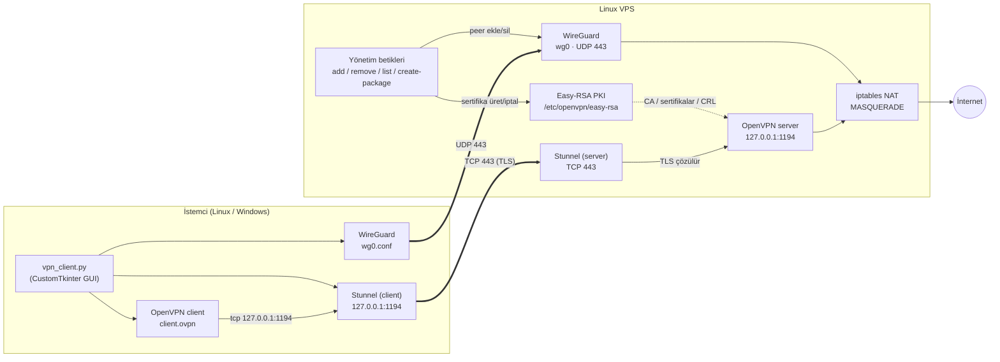

# Mimari

Bu belge Bekre VPN'in tasarımını, bileşenlerini ve **bilinen sınırlarını** açıklar. Projeyi ticari veya bağımsız olarak denetlenmiş bir güvenlik ürünü olarak sunmaz; kişisel ve eğitim amaçlı bir referans uygulamadır. Doğrulama durumu için [TESTING.md](TESTING.md), güvenlik bulguları için [SECURITY.md](SECURITY.md) belgesine bakın.

## 1. Amaç ve kapsam

Tek bir Linux VPS üzerinde, iki farklı taşıma yöntemiyle erişilebilen kişisel bir VPN altyapısı kurmak:

- **Hızlı mod:** WireGuard (UDP 443).
- **Alternatif mod:** TLS tüneli (Stunnel) içinde OpenVPN (TCP 443). UDP'nin kısıtlandığı ağlarda bağlantı kurabilmek için.

Kapsam içinde: sunucu şablonları, kullanıcı ekleme/silme betikleri, istemci yapılandırma paketi üretimi, Linux/Windows GUI istemcisi, EXE derleme hattı.
Kapsam dışında: OpenVPN `server.conf`, Fail2Ban/SSH/DoT sunucu sertifikasyonu, izleme paneli, çoklu sunucu, ticari kullanım.

> VPN'in kullanımı, bulunulan ağın politikalarına ve yürürlükteki yasalara uygun olmalıdır; bu sorumluluk kullanıcıya aittir.

## 2. Sistem diyagramı

Notlar: Diyagramdaki `OpenVPN server → NAT` bağlantısı ve `server.conf` repoda **bulunmaz**; referans ortamda varsayılan bir yapılandırmaya dayanır ve burada doğrulanmamıştır.

## 3. Bileşenler

### WireGuard (hızlı mod)
- Sunucu: `server/configs/wg0.conf.template`; `10.0.0.1/24`, UDP 443. Peer'lar `add-user.sh` ile `wg0.conf` sonuna eklenir.
- İstemci: her kullanıcı için ayrı anahtar çifti; `AllowedIPs = 0.0.0.0/0, ::/0` ile tüm trafik tünele yönlendirilir; `DNS = 1.1.1.1`.
- NAT: sunucu `PostUp` kuralıyla `eth0` üzerinden MASQUERADE yapar (arayüz adı ortama göre değişebilir; `net.ipv4.ip_forward=1` gerekir).

### OpenVPN + Stunnel (alternatif mod)
- İstemci OpenVPN, `127.0.0.1:1194`'e TCP ile bağlanır; orada çalışan istemci tarafı Stunnel bunu `SUNUCU_IP:443` adresine TLS ile taşır.
- Sunucuda Stunnel 443/TCP'yi karşılar ve TLS'i çözüp `127.0.0.1:1194`'teki OpenVPN'e iletir. OpenVPN dışarıya doğrudan açık olmamalıdır.
- İki katmanlı TLS vardır: dış katman (Stunnel) ve iç katman (OpenVPN'in kendi TLS'i).

## 4. TLS ve PKI mimarisi

- **PKI:** Easy-RSA. Sunucuda tek bir CA; `build-ca` ile oluşturulan CA anahtarı parola ile şifrelidir.
- **Sunucu sertifikası:** `build-server-full server nopass` (parolasız).
- **İstemci sertifikaları:** kullanıcı başına `build-client-full <ad> nopass` (parolasız); `client.ovpn` içine CA, sertifika ve özel anahtar gömülür.
- **İç katman doğrulaması:** `client.ovpn` içinde `remote-cert-tls server` vardır ve CA gömülüdür; OpenVPN sunucu kimliğini bu CA ile doğrular.
- **Dış katman (Stunnel):** üretilen istemci `stunnel.conf` sunucu sertifikasını **doğrulamaz** (`verifyChain`/`verifyPeer` tanımlı değildir). İç katman kimlik doğrulaması bunu telafi eder, ancak dış TLS tek başına kimlik doğrulamaz. Ayrıntı: [SECURITY.md](SECURITY.md).
- **WireGuard** PKI kullanmaz; her kullanıcının açık/özel anahtarı vardır.

## 5. Kullanıcı yönetimi

| Betik | İşlev |
|---|---|
| `add-user.sh <ad>` | Sertifika üretir, WireGuard anahtarını ve peer'ı ekler, istemci config'lerini `/root/clients/<ad>/` içine yazar |
| `remove-user.sh <ad>` | Sertifikayı iptal eder, CRL üretir, peer'ı siler, kullanıcı dosyalarını ve `/root/packages/` altındaki paket dizini/zip/sha256'yı kaldırır |
| `list-users.sh` | Kullanıcıları ve WireGuard el sıkışma durumunu listeler |
| `create-package.sh <ad>` | Kullanıcıya gönderilecek `configs/` + yükleyici + GUI içeren `.zip` ve SHA256 üretir |

Eşzamanlılık: `add-user.sh`, `remove-user.sh` ve `create-package.sh` aynı kilidi (`/etc/wireguard/.bekre-vpn.lock`, `flock`) tüm işlem boyunca tutar (`create-package.sh` kullanıcı yoksa `add-user.sh`'ı kilitsiz çağırır, kilidi sonra alır). IP atama `ip_registry` sayacıyla yapılır, yeni IP `wg0.conf` içinde zaten kullanılıyorsa işlem durur.

Hata yönetimi: `add-user.sh` registry/IP doğrulamalarını sertifika üretiminden önce, sertifikayı da WireGuard/IP durumuna dokunmadan önce yapar. Sonraki bir adım başarısız olursa (veya SIGTERM/SIGINT/SIGHUP gelirse) peer, anahtar dosyaları ve kullanıcı dizini geri alınır. **Sınırlar:** üretilmiş sertifika otomatik iptal edilmez (iptal komutu yazdırılır), `ip_registry` sayacı geri alınmaz, SIGKILL/ani kapanmada geri alma çalışmaz.

Paketler: `create-package.sh` çıktısı kullanıcının özel anahtarlarını içerir; `remove-user.sh` sunucudaki kopyaları siler, kullanıcıya iletilmiş kopyalar geri alınamaz.

## 6. Sertifika yaşam döngüsü

1. **Üretim:** `add-user.sh` → `easyrsa build-client-full` (CA parolası gerekir).
2. **Dağıtım:** `create-package.sh` ile paketlenir; paket özel anahtar içerir, güvenli kanaldan iletilmelidir.
3. **Kullanım:** `client.ovpn` sertifikayı taşır; WireGuard için ayrı anahtar çifti kullanılır.
4. **İptal:** `remove-user.sh` → `easyrsa revoke` + `gen-crl`. İptalin etkili olması için OpenVPN `server.conf` içinde `crl-verify` bulunmalıdır (repo dışı, doğrulanmadı).
5. **Süre dolumu / yenileme:** Sertifikaların geçerlilik süresi Easy-RSA varsayılanına bağlıdır; yenileme için bir betik **yoktur**.

## 7. Linux ve Windows istemcileri

| Konu | Linux | Windows |
|---|---|---|
| Yetki | Her komut `pkexec` ile (polkit gerekir) | GUI yönetici olarak çalıştırılır |
| WireGuard | `wg-quick up/down`; config `/etc/wireguard/wg0.conf` üzerine kopyalanır (mevcut dosyanın üzerine yazılır) | `wireguard.exe /installtunnelservice` |
| Kill switch | `wg0.conf` içindeki iptables `PostUp/PreDown` (yalnızca IPv4, yalnızca WireGuard modu) | **Yok** |
| OpenVPN modu kill switch | Yok | Yok |
| Süreç yönetimi | Yalnızca bu istemcinin kendi yapılandırma dosyasıyla başlattığı süreçler `pkill -f` ile durdurulur | Yalnızca bu istemcinin başlattığı süreçlerin PID'leri `taskkill` ile sonlandırılır (çalışma zamanında test edilmedi) |
| Dağıtım | Sanal ortamda (`.venv/bin/python client/vpn_client.py`); sistem Python'una `--break-system-packages` ile kurulum önerilmez | PyInstaller ile derlenmiş, imzasız EXE |

## 8. Güvenlik sınırları (ne korur, ne korumaz)

- Tünel, istemci ile sunucu arasındaki trafiği şifreler; sunucudan internete çıkış sonrası trafik şifrelenmez.
- Sunucu sağlayıcısına ve sunucu yöneticisine güven gerekir; bu bir anonimlik aracı değildir.
- Kill switch tam koruma değildir (bkz. tablo); DNS ve IPv6 sızıntı korumaları bu çalışmada test **edilmemiştir**.
- CA anahtarı internete açık sunucudadır; parola ile şifreli olsa da sunucu ele geçirilirse risk büyür.
- Kullanıcı sertifika/anahtarları sunucuda `/root/clients/` altında saklanır.
- Bu proje bağımsız bir profesyonel güvenlik denetiminden geçmemiştir; yapılan incelemeler yapay zekâ destekli kod incelemeleri ve mock testlerdir ([TESTING.md](TESTING.md)).
- Kullanıcı paketleri ve sunucudaki `/root/clients/` özel anahtar içerir.

## 9. Bilinen teknik kısıtlamalar

- OpenVPN `server.conf`, `crl-verify`, OpenVPN alt ağı için NAT ve DNS itme (`push`) ayarları repoda yoktur.
- `ip_registry` yalnızca artan bir sayaçtır; silinen kullanıcıların IP'leri yeniden kullanılmaz (havuz en fazla 251 kullanıcı oluşturma ile tükenir).
- Her ekleme/silme `wg-quick@wg0` yeniden başlatır; aktif WireGuard oturumları kısa süre kesilir.
- Sunucu şablonundaki `FORWARD` kuralı yalnızca `wg0`'dan gelen paketleri kabul eder; varsayılan politika `ACCEPT` varsayılır.
- Şablon `eth0` varsayar; farklı arayüz adı için elle düzeltme gerekir.
- IPv6 sunucuda `PostUp` ile tüm sistem için kapatılır (yan etkisi vardır).
- İstemci, genel IP'yi `ifconfig.me` (üçüncü taraf) ile sorgular.

## 10. Teknoloji seçimlerinin nedenleri

| Teknoloji | Neden |
|---|---|
| WireGuard | Küçük kod tabanı, hızlı el sıkışma, basit anahtar yönetimi |
| OpenVPN + Stunnel | TCP 443 üzerinden TLS trafiği gibi görünerek UDP'nin kısıtlandığı ağlarda çalışabilmek |
| Easy-RSA | OpenVPN için standart, basit PKI aracı; ek bağımlılık gerektirmez |
| Bash betikleri | Kurulum ve kullanıcı yönetimini sade tutmak; tek VPS için yeterli |
| Python + CustomTkinter | Linux ve Windows'ta tek kod tabanı ile GUI |
| PyInstaller + GitHub Actions | Windows kullanıcısı için tek dosyalık EXE ve tekrarlanabilir derleme |
